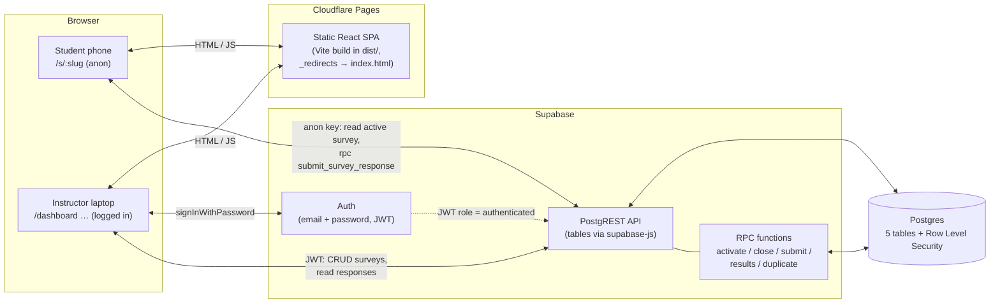
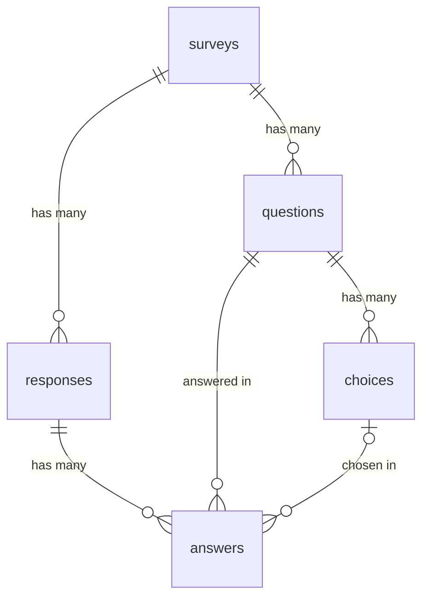

# Classroom Survey

A free, open-source web app for quick in-class understanding checks. The instructor prepares a survey, activates it with one click and projects a QR code; students scan it with their phones and answer without logging in; results appear as counts, percentages and charts and are kept for later.

Course project for CSE 4095. Built with an AI coding agent from five specification documents (see [Documentation](#documentation)).

---

## Features

**Instructor (logged in)**
- Email/password login (Supabase Auth); all instructor pages are protected.
- Dashboard: every survey with a text status badge (Draft / Active / Closed / Archived), created date and response count; search by title, filter by status and created-date range.
- Create, edit, duplicate ("Copy of …"), archive and delete surveys (confirmation dialogs; stronger warning when deleting a survey with responses).
- Editor: title, optional description, Multiple Choice and True / False questions, add / delete / reorder questions and choices, inline validation, "Saving... / Saved", unsaved-changes warning.
- Activate / close surveys. Only one survey can be active; activating another closes the current one.
- Present page for the projector: large QR code, readable URL with Copy, live response count (every 5 s), Download QR (PNG), Fullscreen.
- Results: total responses, per-question bar charts (Recharts) with count and percentage text for every choice, Refresh, results for closed and archived surveys.
- CSV export (one row per response, survey summary, Excel-friendly, formula-injection safe).

**Student (no login)**
- Opens `/s/<slug>` from the QR code; mobile-first single-column form with large tap targets.
- All questions required; unanswered ones are highlighted.
- Confirmation screen; friendly messages for closed surveys, unknown links and repeat submissions.
- Duplicate protection: one response per browser (anonymous token in localStorage + unique index in the database).

---

## Architecture



- **Frontend:** React 19 + TypeScript + Vite + Tailwind CSS 4 + React Router 7, Recharts for charts, `qrcode` for QR codes. It is a static single-page app; Cloudflare Pages only serves files.
- **Backend:** Supabase. The browser talks to it directly with `@supabase/supabase-js` using the public **anon key**. Logged-in requests carry the instructor's JWT, so Postgres sees the role `authenticated`; student requests run as `anon`.
- **Security lives in the database:** Row Level Security policies and function privileges decide what each role may do, not the frontend.

---

## Database

Defined entirely in [`supabase/migrations/`](supabase/migrations/) (see [DATABASE.md](DATABASE.md) for the design and [DECISIONS.md](DECISIONS.md) for a plain-English explanation of every policy and function).



| Table | Purpose | Key columns |
|---|---|---|
| `surveys` | Survey metadata | `id` PK, `title`, `description`, `status` (`draft`/`active`/`closed`/`archived`, CHECK), `public_slug` (unique), `created_at`, `updated_at` (trigger) |
| `questions` | Questions of a survey | `id` PK, `survey_id` FK → surveys (cascade), `question_text`, `question_type` (`multiple_choice`/`true_false`), `position` (unique per survey) |
| `choices` | Answer options (True/False are stored as two choices) | `id` PK, `question_id` FK → questions (cascade), `choice_text`, `position` (unique per question) |
| `responses` | One student submission | `id` PK, `survey_id` FK → surveys (cascade), `anonymous_token`, `submitted_at`; unique `(survey_id, anonymous_token)` |
| `answers` | One answer to one question | `id` PK, `response_id` FK → responses (cascade), `question_id` FK → questions, `choice_id` FK → choices (set null); unique `(response_id, question_id)` |

A partial unique index (`only_one_active_survey`) guarantees at most one active survey.

**Row Level Security** is enabled on all five tables:
- `anon` (students) may only **read** surveys whose status is `active`, plus their questions and choices. All other table privileges are revoked, so students cannot read responses/answers (results) or create/change/delete anything.
- Students submit only through `submit_survey_response(...)`, a `SECURITY DEFINER` function that validates everything (survey active, question/choice belong together, every question answered, no duplicate token) and inserts the response and answers in one transaction.
- `authenticated` (the instructor) has full access. Because of this, **public sign-ups must be disabled** in Supabase Auth.

RPC functions: `activate_survey`, `close_survey`, `submit_survey_response`, `get_survey_results`, `duplicate_survey`, `get_survey_status_by_slug`.

---

## Local setup

Requirements: Node.js 22.12 or newer, a free [Supabase](https://supabase.com) project.

1. **Clone and install**
   ```bash
   git clone https://github.com/<your-username>/classroom-survey.git
   cd classroom-survey
   npm install
   ```
2. **Environment variables** — copy `.env.example` to `.env.local` and fill in the values from Supabase → Project Settings → API (Project URL and the **anon / publishable** key only — never the service-role key):
   ```bash
   cp .env.example .env.local
   ```
   ```ini
   VITE_SUPABASE_URL=https://<project-ref>.supabase.co
   VITE_SUPABASE_ANON_KEY=<anon key>
   VITE_PUBLIC_SITE_URL=            # optional, e.g. your Cloudflare Pages URL
   ```
3. **Run the migrations in order** — Supabase → SQL Editor → New query, paste and run each file:
   1. `supabase/migrations/20261102000100_initial_schema.sql`
   2. `supabase/migrations/20261102000200_rpc_functions.sql`

   (With the Supabase CLI linked to the project, `supabase db push` does the same.)
4. **Check permissions** — run `supabase/tests/rls_checks.sql` in the SQL Editor; every row must say `PASS`. Optionally run `npx tsx scripts/rls-probe.ts`.
5. **Disable public sign-ups** — Authentication → Sign In / Providers → turn off "Allow new users to sign up". Every logged-in user is treated as an instructor.
6. **Create the instructor account** — Authentication → Users → Add user → Create new user (email + password, "Auto Confirm User").
7. **Start the app**
   ```bash
   npm run dev
   ```
   Open http://localhost:5173 and log in.

| Command | What it does |
|---|---|
| `npm run dev` | Development server |
| `npm test -- --run` | Unit and component tests (Vitest) |
| `npm run lint` / `npm run format` | ESLint / Prettier |
| `npm run build && npm run preview` | Production build and local preview |
| `npx tsx scripts/rls-probe.ts` | Probe the live database with the anon key |

---

## Deployment (Cloudflare Pages)

1. Push the repository to GitHub.
2. Cloudflare dashboard → Workers & Pages → Create → Pages → **Connect to Git** → choose the `classroom-survey` repository.
3. Build settings:
   - Framework preset: **None** (or Vite)
   - Build command: **`npm run build`**
   - Build output directory: **`dist`**
4. Environment variables (Production, and Preview if you use preview deployments) — set them **before the first build**, because Vite bakes them into the bundle at build time:
   - `VITE_SUPABASE_URL`
   - `VITE_SUPABASE_ANON_KEY`
   - `VITE_PUBLIC_SITE_URL` = your Pages URL, e.g. `https://classroom-survey.pages.dev` (QR codes point here)
   - `NODE_VERSION` = `22` (the repo also contains `.node-version`)
5. Save and deploy. `public/_redirects` (`/* /index.html 200`) makes deep links such as `/s/abc123` and `/dashboard` work.
6. Supabase → Authentication → **URL Configuration**: set **Site URL** to the Pages URL and add it to **Redirect URLs**.
7. After changing an environment variable, trigger a new deployment (Deployments → Retry deployment) so the bundle is rebuilt.

---

## Testing

See **[TESTING.md](TESTING.md)**: automated test inventory (Vitest + React Testing Library), database permission tests (`supabase/tests/rls_checks.sql`, `scripts/rls-probe.ts`) and the manual end-to-end test plan with results.

---

## Grader access

Demo instructor credentials are provided privately via **HuskyCT**. No credentials are stored in this repository.

---

## Documentation

- Specifications (source of truth):
  - [Classroom_Survey_Web_App_Specification.md](Classroom_Survey_Web_App_Specification.md)
  - [TODO.md](TODO.md) — implementation phases (only verified items are checked)
  - [DATABASE.md](DATABASE.md)
  - [API.md](API.md)
  - [UI.md](UI.md)
- [DECISIONS.md](DECISIONS.md) — decisions where the specs were silent or inconsistent, and a plain-English explanation of the RLS policies and functions
- [AI_HISTORY.md](AI_HISTORY.md) — log of every prompt given to the AI agent, what it did, and the problems found and fixed
- [TESTING.md](TESTING.md) — test plan and results
- [DEVELOPMENT_SUMMARY.md](DEVELOPMENT_SUMMARY.md) — development summary

## Project structure

```text
├── src/
│   ├── components/     shared UI (layouts, dialogs, badges, chart, auth provider)
│   ├── pages/          one component per route
│   ├── lib/            supabase client, API calls, CSV, validation and other helpers
│   └── test/           component tests and test setup
├── supabase/
│   ├── migrations/     timestamped SQL migrations (schema, RLS, RPC functions)
│   └── tests/          rls_checks.sql
├── scripts/            rls-probe.ts
├── public/             _redirects, favicon
└── *.md                specifications and project documentation
```

## License

The specification calls for an open-source project. No license file has been added yet — choose one (for example MIT) and add a `LICENSE` file before publishing.
